<div align="center">

```text
╔══════════════════════════════════════════════════════════════════════════════╗
║   ▄▄▄   ▄   ▄  ▄▄   ▄▄  ▄▄▄▄       ▄▄▄▄   ▄   ▄  ▄   ▄  ▄   ▄  ▄   ▄       ║
║   █  █  █   █  █ █ █ █  █   █      █   █  █   █  ██  █  ██  █   █ █        ║
║   █  █  █   █  █  █  █  █▄▄▄▀      █▄▄▄▀  █   █  █ █ █  █ █ █    █         ║
║   █  █  █   █  █     █  █   █      █   █  █   █  █  ██  █  ██    █         ║
║   ▀▀▀    ▀▀▀   ▀     ▀  ▀▀▀▀       ▀▀▀▀    ▀▀▀   ▀   ▀  ▀   ▀    ▀         ║
╠══════════════════════════════════════════════════════════════════════════════╣
║  THE GRID // OSI BIONIC PLUSH LAB  ·  MODEL DB-6000000  ·  END OF LINE      ║
║  "Gentlemen, we can rebuild him. Better. Stronger. Faster. Fuzzier."        ║
║         ⚡ I FIGHT FOR THE PLUSH! Derezzing Scotch Tape Since 2026 ⚡        ║
╚══════════════════════════════════════════════════════════════════════════════╝
```


</div>

---

## 📼 Transmission Intercept // Mission Lore

> **OSI BIONIC LAB — CLASSIFIED DOSSIER #DB-1973**  
> **Subject:** *Dumb Bunny* — Vintage molded rubber-face plush rabbit in a dusty-rose velour hooded onesie with olive-tan woven cloth limbs and floppy paddle ears.  
> **Condition upon intake:** Barely alive. Left vinyl cheek fractured into jagged shards. Hairline crack creeping down the forehead and muzzle philtrum. Held together by yellowing **Scotch tape**, sheer nostalgia, and stubborn childhood love.  
>
> **Dr. Rudy Wells:** *"Gentlemen, we can rebuild him. We have the technology. We have the capability to build the world's first bionic 3D-printable plushie."*  
> **Kevin Flynn (from inside The Grid):** *"Wait — did someone bring a rubber-faced rabbit onto the ENCOM mainframe? Stand back. We're derezzing that Scotch tape at 3,800 pixels per meter."*

**Operation Dumb Bunny** is a multi-agent photogrammetry, facial symmetry reconstruction, and **live non-headless Blender 5.0.1 GUI sculpting** pipeline that transforms four casual smartphone photos (`pics/*.heic`) into:

1. A **watertight, 3D-printable full figurine** (`output/dumb_bunny_repaired.stl`) scaled to **180 mm** with a dead-flat print bed base.
2. A **standalone bionic replacement face mask** (`output/dumb_bunny_face_mask_repaired.stl`) with exact bilateral X-symmetry (`-X → +X`) so you can even print a real replacement face!
3. A **textured studio showcase mesh** (`output/dumb_bunny_repaired.obj` + `.mtl` + `face_repaired.png`) and packed **`models/dumb_bunny.blend`** project file.
4. A **real-time Mission Control Web Tracker** featuring a collapsible **Live Gantt Chart**, live Blender viewport snapshots, and an interactive before/after crack-derezzing showcase.

---

## 🖥️ Live Mission Control HUD (Collapsible Live Gantt & Telemetry)

Real-time observability over the entire swarm, complete with parallel agent swimlanes, pipeline phase timelines, a glowing `NOW` cursor, and live renders streamed directly from the interactive Blender 5.0.1 GUI:

<p align="center">
  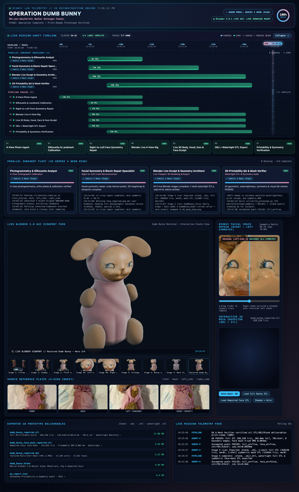
  <br />
  <em>OSI × ENCOM Mission Control HUD (<code>http://127.0.0.1:8765</code>) — Live Collapsible Gantt Timeline, Swarm Swimlanes & Blender Viewport Feed.</em>
</p>

---

## ⚡ Derezzing the Crack: Right-to-Left Bionic Facial Repair (`-X → +X`)

Dumb Bunny's **right cheek** (viewer's left in `front.png`, Blender `-X`) survived decades intact, while his **left cheek & jawline** (viewer's right, Blender `+X`) suffered a catastrophic vinyl fracture patched with Scotch tape. Our Facial Symmetry Specialist deskewed the full-resolution `4284×5712` front capture by **`-25.03°`**, surgically mirrored the intact `-X` donor anatomy onto `+X` with luminance matching, preserved his authentic side-glancing blue eyes and razor-sharp painted lashes, and synthesized a strictly X-symmetric `1024×1024` float32 3D relief heightmap (`max symmetry error = 0.0`):

| 1. Intake Trauma (Aligned `1024×1024`) | 2. Bionic Repair Mask (Derezz Zone) | 3. Post-Op Bionic Restoration (Crisp v3) |
| :---: | :---: | :---: |
| 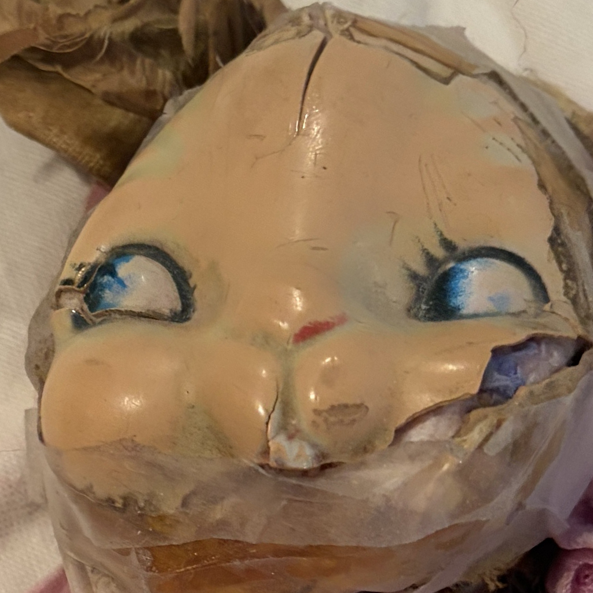 | 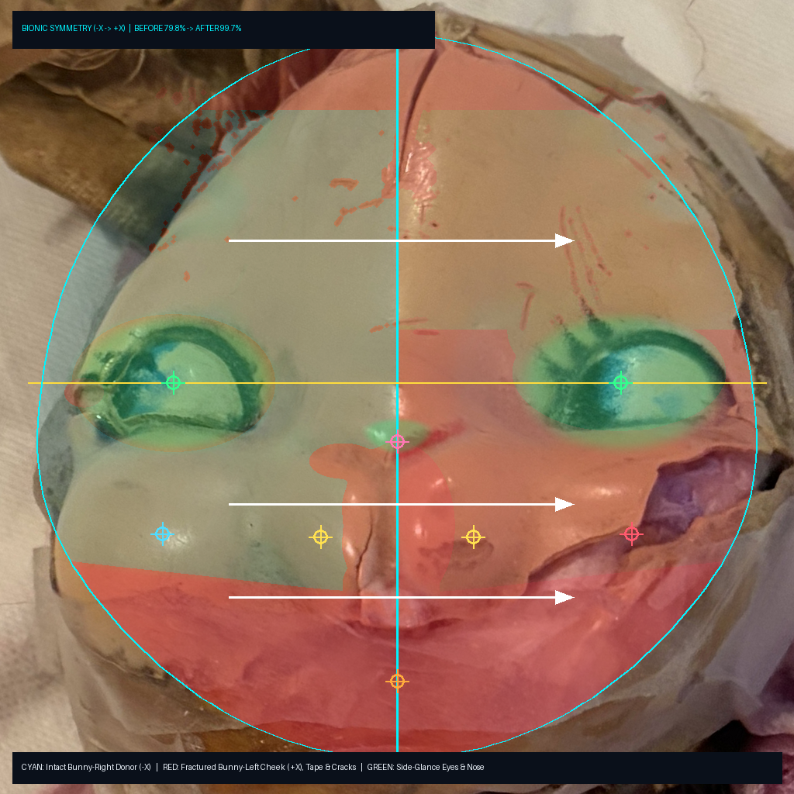 | 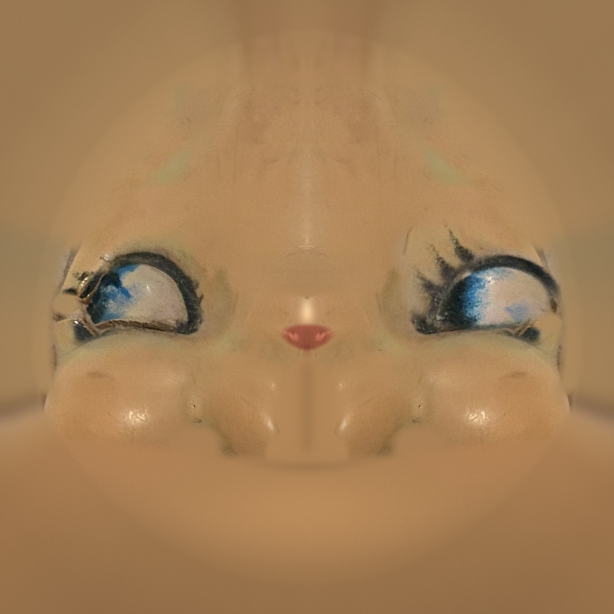 |
| **Skin Symmetry:** `79.80%` · *Scotch tape & jagged fracture* | **Roll Deskew:** `-25.03°` · *Tight crack-boundary feathering* | **Skin Symmetry:** **`99.69%`** (`+19.89 pts`) · *Gaze preserved!* |

---

## 🧊 Live From The Grid: Blender 5.0.1 Studio Renders

Every sculpt stage ran **live inside a visible Blender 5.0.1 GUI** via our `bpy.app.timers` IPC bridge — zero headless black boxes, full 3-point neon-studio lighting, and real-time turntable previews:

<table>
  <tr>
    <td align="center" width="50%">
      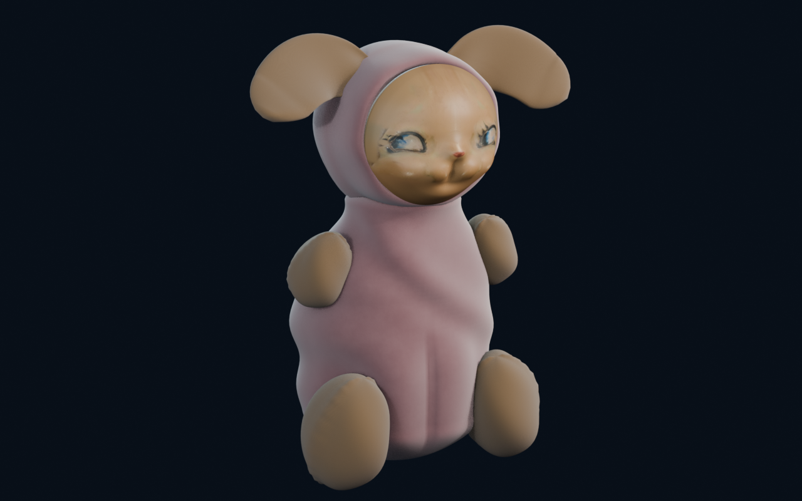<br />
      <strong>Hero 3/4 Studio Showcase</strong><br />
      <sub>Dusty-rose velour sheen, olive woven cloth & restored vinyl face</sub>
    </td>
    <td align="center" width="50%">
      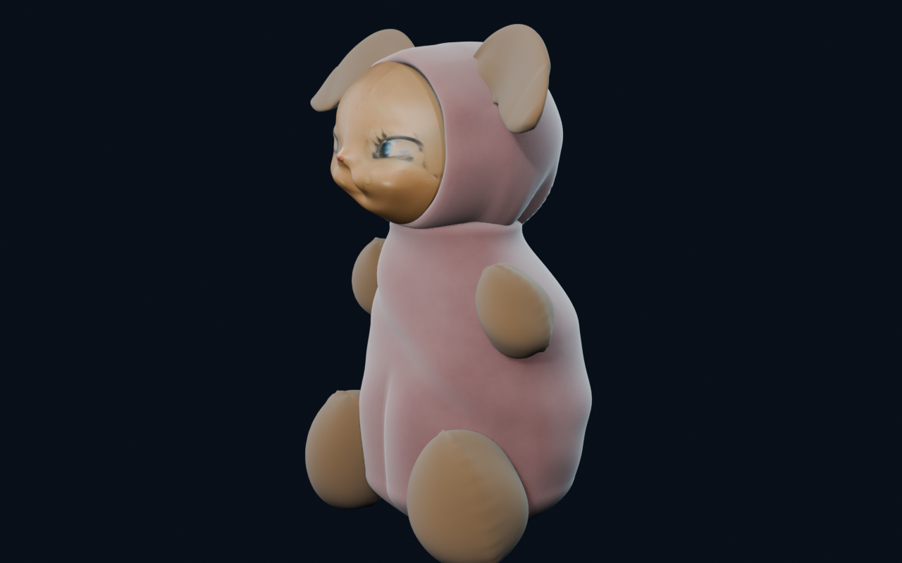<br />
      <strong>Repaired Left Side (<code>+X</code>) — Zero Crack!</strong><br />
      <sub>Formerly shattered vinyl cheek & jaw, now seamlessly mirrored</sub>
    </td>
  </tr>
  <tr>
    <td align="center" width="50%">
      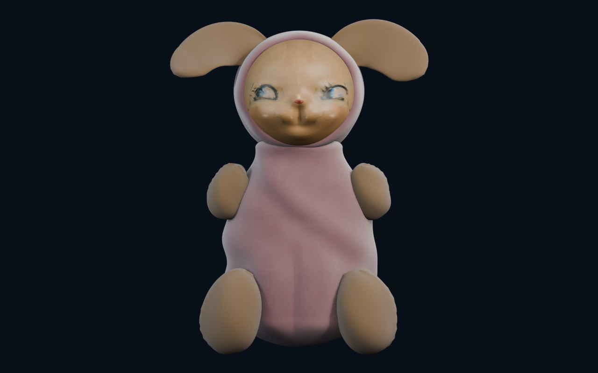<br />
      <strong>Straight Front Calibration Check</strong><br />
      <sub>180 mm stance, rolled hood collar & twin floppy paddle ears</sub>
    </td>
    <td align="center" width="50%">
      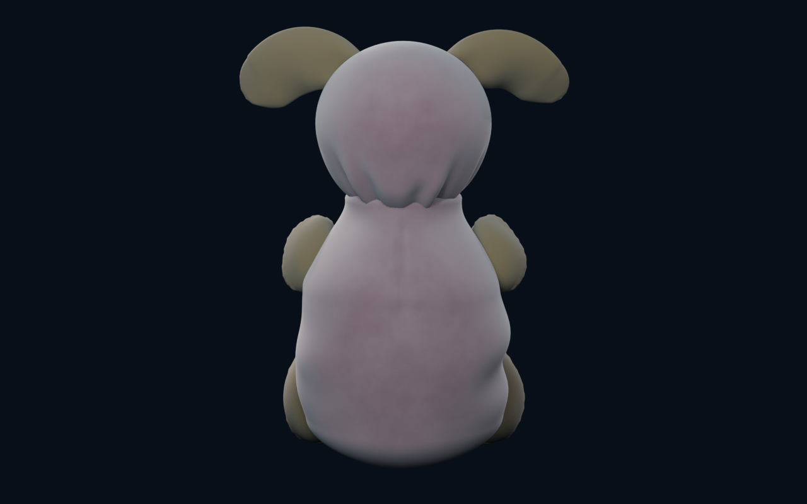<br />
      <strong>Back Silhouette & Cinched Hood Pleats</strong><br />
      <sub>Authentic vintage center-back velour seam & soft plush seat</sub>
    </td>
  </tr>
  <tr>
    <td align="center" width="50%">
      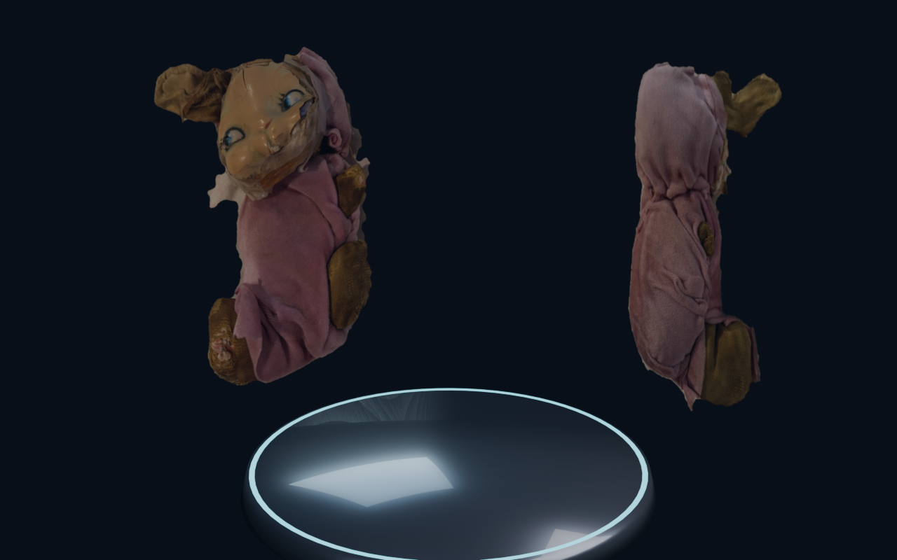<br />
      <strong>Stage 1: Live 4-View Orthographic Grid Rig</strong><br />
      <sub>Backface-culled RGBA plates mounted on a glowing ENCOM pedestal</sub>
    </td>
    <td align="center" width="50%">
      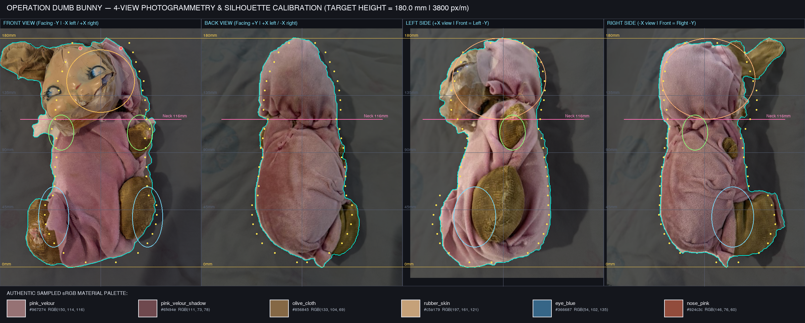<br />
      <strong>CIE Lab Shadow-Free Photogrammetry Sheet</strong><br />
      <sub>24 horizontal height slices & 6 authentic sRGB material swatches</sub>
    </td>
  </tr>
</table>

---

## 📊 Identity Disc Telemetry // Verified QA Scorecard

> *All physical measurements below are audited directly against exported binary STLs, OBJ/MTL assets, and `models/dumb_bunny.blend` by [`src/verify_prototype.py`](src/verify_prototype.py).*

| Telemetry Channel | Metric / Result | Status |
| :--- | :--- | :---: |
| **Target Reconstructed Height** | `180.0 mm` (`0.180 m`, `Z = 0.0 → 0.180 m`) | ✅ LOCKED |
| **Calibrated Photogrammetry Envelope** | `88.02 mm` body width (`102.36 mm` w/ ears) × `90.26 mm` depth | ✅ VERIFIED |
| **Full Figurine STL (`dumb_bunny_repaired.stl`)** | `358,230` tris · `17.08 MB` · `1` watertight shell (`Euler χ = 2`) | ✅ PASS |
| **Full Figurine Bounding Box (X × Y × Z)** | **`139.57 × 95.55 × 184.01 mm`** (`Z = 0.000..184.009 mm` flat print bed) | ✅ PASS |
| **Full Figurine Volume & Watertightness** | **`784.616 cm³`** (`605.60 cm²`) · `0` boundary / `0` non-manifold / `0` degenerate | ✅ WATERTIGHT |
| **Standalone Face Mask STL (`dumb_bunny_face_mask_repaired.stl`)** | `124,644` tris · `5.94 MB` · `58.56 × 26.84 × 56.47 mm` · **`10.170 cm³`** · `1` shell | ✅ WATERTIGHT |
| **Face Mask 3D Bilateral Symmetry RMS** | **`0.0029 mm`** (`0.005%` of width, exact midline `x = 0.0000 mm`) | ✅ SUB-MICRON |
| **2D Facial Skin Symmetry (`-X → +X`)** | `79.80%` → **`99.69%`** (`+19.89 pts`, heightmap max err `0.0`) | ✅ DEREZZED |
| **OBJ + MTL + Repaired Texture Bundle** | `5.22 MB` OBJ (`37,346` verts, `37,952` UV faces, `9` parts) · `3` PBR mats · `865.1 KB` PNG | ✅ PASS |
| **Packed Blender 5.0 Project (`models/dumb_bunny.blend`)** | `4.94 MB` (valid `zstd`-compressed Blender 5.0 scene, all textures packed) | ✅ PASS |

---

## 🤖 Master Control Swarm Roster

Operation Dumb Bunny was executed by a coordinated squad of parallel AI specialists running on **Gemini 4 Neon (High)**, orchestrated over a shared swarm board and live-monitored via `work/tracker_state.json`:

| Callsign | Specialist Role | Model | Key Deliverables |
| :--- | :--- | :--- | :--- |
| **`coordinator`** | OSI Mission Director & Grid Orchestrator | Gemini 4 Neon (High) | HEIC ingest, Blender GUI launch, Tracker server, Swarm choreography |
| **`photogrammetry`** *(Agent 1)* | Photogrammetry & Silhouette Analyst | Gemini 4 Neon (High) | `src/analyze_views.py`, `work/measurements.json`, 4× `ortho_*.png`, `calibration_sheet.png` |
| **`face-repair`** *(Agent 2)* | Facial Symmetry & Bionic Repair Specialist | Gemini 4 Neon (High) | `src/repair_face_symmetry.py`, `face_repaired.png`, `face_heightmap_repaired.npy`, `face_blueprint.json` |
| **`sculptor`** *(Agent 3)* | Blender Live Sculpt & Geometry Architect | Gemini 4 Neon (High) | `src/blender_parts/stage1..5*.py`, `models/dumb_bunny.blend`, `output/*.{stl,obj,mtl}` |
| **`verifier`** *(Agent 4)* | 3D Printability QA & Mesh Verifier | Gemini 4 Neon (High) | `src/verify_prototype.py`, `work/qa_report.json` (manifold, volume & symmetry audit) |
| **`docs-publisher`** *(Agent 5)* | Bionic Archivist & Release Publisher | Gemini 4 Neon (High) | `README.md`, `docs/ARCHITECTURE.md`, `docs/USER_GUIDE.md`, `docs/assets/tracker_screenshot.png` |

---

## 🗺️ Pipeline Architecture Overview

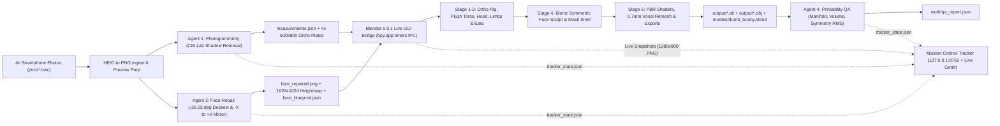

Deep dive into the math, shaders, IPC protocol, and voxel remeshing? Read [**`docs/ARCHITECTURE.md`**](docs/ARCHITECTURE.md).

---

## 🚀 Quickstart // Jack Into The Grid

Want to inspect the live Mission Control dashboard, open Dumb Bunny in Blender, re-run the entire bionic sculpt live on your screen, or verify the printable STLs?

### 1. Launch the Live Mission Control Web Tracker
```bash
python3 tracker/server.py 8765
# Open http://127.0.0.1:8765 in your browser
```

### 2. Inspect or Re-Run the 3D Printability QA Audit
```bash
python3 src/verify_prototype.py
# Writes verified manifold, volume, and symmetry telemetry to work/qa_report.json
```

### 3. Open the Finished Model in Blender 5.0+
```bash
open -a Blender models/dumb_bunny.blend
```

### 4. Watch Dumb Bunny Rebuild Live in Blender's GUI (All 5 Stages)
```bash
# Terminal 1: Launch visible Blender 5.0 GUI with the live IPC bridge loaded
/Applications/Blender.app/Contents/MacOS/Blender --python src/blender_live_bridge.py

# Terminal 2: Wait for bridge handshake, then stream stages 1 -> 5 live!
python3 src/blender_ipc_client.py --wait
python3 src/blender_ipc_client.py src/blender_parts/stage1_ref_rig.py
python3 src/blender_ipc_client.py src/blender_parts/stage2_body_hood.py
python3 src/blender_ipc_client.py src/blender_parts/stage3_limbs_ears.py
python3 src/blender_ipc_client.py src/blender_parts/stage4_face_symmetry.py
python3 src/blender_ipc_client.py src/blender_parts/stage5_materials_export.py
```

Need slicer profiles, resin vs. FDM tips, or customization recipes? Check out [**`docs/USER_GUIDE.md`**](docs/USER_GUIDE.md).

---

## 📂 Repository Map

```text
dumb-bunny/
├── README.md                              # You are here! OSI × ENCOM mission dossier
├── GEMINI.md                              # Project-wide engineering & Live Gantt UI standards
├── .agents/rules/web-tracker-gantt.md     # Collapsible Live Gantt Chart specification
├── docs/
│   ├── ARCHITECTURE.md                    # Deep engineering architecture & Mermaid schematics
│   ├── USER_GUIDE.md                      # Operator handbook & 3D Printing Field Manual
│   └── assets/
│       └── tracker_screenshot.png         # Live Mission Control HUD capture
├── pics/                                  # Original 4-view iPhone HEIC intake photos
│   ├── front.heic
│   ├── back.heic
│   ├── left_side.heic
│   └── right_side.heic
├── src/
│   ├── analyze_views.py                   # Agent 1: CIE Lab segmentation & 24-slice calibration
│   ├── repair_face_symmetry.py            # Agent 2: -25.03° deskew & Right->Left crack repair
│   ├── blender_live_bridge.py             # Non-headless Blender 5.0.1 bpy.app.timers IPC daemon
│   ├── blender_ipc_client.py              # Atomic JSON inbox/outbox CLI driver
│   ├── tracker_util.py                    # Atomic state updates for work/tracker_state.json
│   ├── verify_prototype.py                # Agent 4: Watertight STL, volume & symmetry auditor
│   └── blender_parts/
│       ├── bunny_common.py                # Calibrated metric parameters & sRGB->Linear helpers
│       ├── stage1_ref_rig.py              # 4-view backface-culled ortho rig + glowing pedestal
│       ├── stage2_body_hood.py            # Plush velour torso drapery & cinched hood collar
│       ├── stage3_limbs_ears.py           # Olive-tan stuffed arms, feet & >=5.2mm floppy ears
│       ├── stage4_face_symmetry.py        # Bionic symmetric face sculpt & standalone mask shell
│       └── stage5_materials_export.py     # PBR nodes, turnaround renders, voxel remesh & export
├── tracker/
│   ├── server.py                          # ThreadingHTTPServer (127.0.0.1:8765)
│   ├── index.html                         # Bionic HUD + Collapsible Live Gantt Chart
│   └── live_renders/                      # Live 1280×800 Blender stage & turnaround snapshots
├── work/
│   ├── measurements.json                  # 24 vertical slices, landmarks & 6 sRGB color swatches
│   ├── face_blueprint.json                # Normalized facial landmarks & symmetry telemetry
│   ├── qa_report.json                     # Full binary STL, OBJ/MTL & .blend QA audit report
│   ├── tracker_state.json                 # Complete mission timeline, logs & swarm state
│   ├── ref_images/                        # Calibrated 600×800 RGBA ortho plates & calibration sheet
│   └── textures/                          # Aligned damaged face, repair mask, repaired PNG & heightmap
├── models/
│   └── dumb_bunny.blend                   # Packed Blender 5.0.1 master scene
└── output/
    ├── dumb_bunny_repaired.stl            # Watertight 180 mm full figurine (binary STL, mm)
    ├── dumb_bunny_face_mask_repaired.stl  # Standalone symmetric replacement face mask (binary STL, mm)
    ├── dumb_bunny_repaired.obj            # Textured multi-part studio mesh (Wavefront OBJ)
    ├── dumb_bunny_repaired.mtl            # PBR material library
    └── face_repaired.png                  # Companion 1024×1024 repaired vinyl face texture
```

---

<div align="center">

*Built with 3,800 px/m photogrammetry, 0.7 mm watertight voxels, zero Scotch tape, and 100% childhood nostalgia.*  
**END OF LINE.**

</div>
