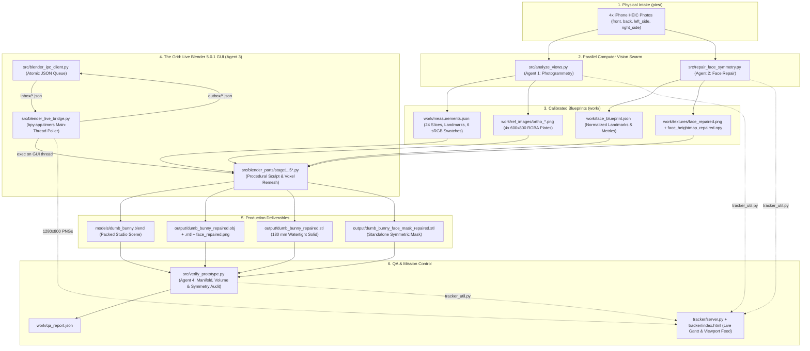
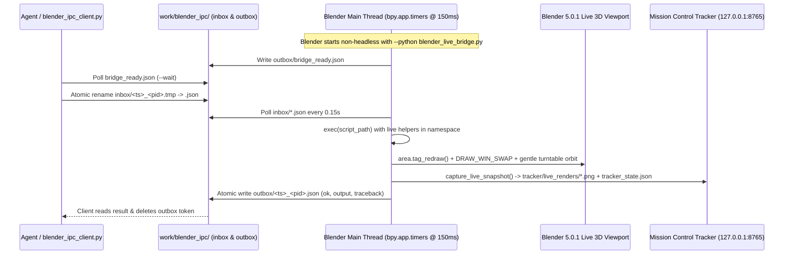

# 🧬 Operation Dumb Bunny — System Architecture

> **CLASSIFICATION:** OSI Bionic Lab × ENCOM Grid Technical Schematic  
> **CODENAME:** `DB-6000000` ("We can rebuild him. Better. Stronger. Faster. Fuzzier.")  
> **TARGET SCALE:** `0.180 m` (`180.0 mm`) Metric Right-Handed Z-Up Coordinate System

---

## 1. Architectural Philosophy: No Black Boxes on The Grid

Most automated 3D reconstruction pipelines run silently in headless containers and spit out a mysterious mesh ten minutes later. **Operation Dumb Bunny** rejects the headless black box in favor of **Glass-Box Bionic Engineering**:

1. **Deterministic, Calibrated Metric Ground Truth:** Every millimeter in Blender derives from `work/measurements.json` and `work/face_blueprint.json`, locked to a single coordinate standard (`+Z` up, `-Y` front, `-X` bunny's right / donor side, `+X` bunny's left / repaired side).
2. **Non-Headless Live Blender 5.0.1 GUI Execution:** A `bpy.app.timers` bridge runs inside an actual visible Blender desktop window so operators watch the 4-view orthographic rig, plush velour torso, floppy ears, and symmetric bionic face materialize in real time.
3. **Strict Right-to-Left (`-X → +X`) Bionic Repair:** Rather than blurring or hallucinating away the vinyl fracture with destructive global filters, we deskew the full-resolution `4284×5712` front capture, mirror the intact `-X` cheek/jaw onto `+X` with tight crack-boundary feathering, preserve the real photographic forehead and side-glancing blue eyes, and enforce mathematical X-symmetry on the 3D relief heightmap and standalone face mask STL.
4. **Dual-Track Geometry Export:** High-fidelity multi-part UV-mapped PBR meshes for visual showcase (`.blend`, `.obj`/`.mtl`) *and* voxel-remeshed, strictly 2-manifold watertight binary STLs scaled to millimeters (`×1000`) for immediate 3D printing.
5. **Zero-Dependency Mission Control Observability:** A local Python `ThreadingHTTPServer` serves a single-file obsidian/cyan HUD with a **Collapsible Live Gantt Chart** (`GEMINI.md` standard) polling atomic JSON snapshots (`work/tracker_state.json`).

---

## 2. High-Level System Topology

---

## 3. Coordinate System & Photogrammetry Calibration (`src/analyze_views.py`)

Dumb Bunny is photographed resting on a light patterned sheet, creating soft gray cast shadows that fool naive luminance thresholds. Agent 1 solves this via **CIE Lab chromaticity invariance**:

- **Shadow-Invariant Segmentation:** Converts each sRGB photo to linear RGB → XYZ → CIE $L^*a^*b^*$ and HSV. Because cast shadows darken $L^*$ while leaving chromaticity $(a^*, b^*)$ near the white sheet's neutral point, foreground masks cleanly isolate the dusty-rose velour, olive-tan woven cloth, and warm peach vinyl without capturing table shadows.
- **Unified Metric Scale (`3,800 px/m`):**
  - Target total height: **`0.180 m` (`180.0 mm`)** spanning `Z = 0.000 m` (bottom seat) to `Z = 0.180 m` (hood crown).
  - Each orthographic plate is normalized to `600×800` RGBA with `bunny_top_px = 58` and `bunny_bottom_px = 742` (`684 px = 0.180 m`, `0.2632 mm/px`).
  - Resulting Blender reference plane dimensions: **`0.15789 m × 0.21053 m`**, centered at `Z = 0.090 m` (`Z ∈ [-0.01526, +0.19526]`).
- **24-Slice Volumetric Profiling & Landmarks:** Extracts 24 horizontal cross-sections (`z_norm ∈ [0.02, 0.98]`), front/back belly profiles, neck pinch (`Z = 116.3 mm`), head ellipsoid (`center = [0, -0.00314, 0.14815]`), face oval (`53.34 mm × 49.40 mm`), stubby arms, oval feet, and floppy paddle ears (`56.0 mm` length, `25.43 mm` width).
- **Authentic Material Swatches (sRGB & Linear):** Samples `pink_velour` (`#967274`), `pink_velour_shadow` (`#6f494e`), `olive_cloth` (`#856845`), `rubber_skin` (`#c5a179`), `eye_blue` (`#366687`), and `nose_pink` (`#924c3c`) directly into `work/measurements.json`.

### Canonical Axis Convention
| Axis | Direction | Anatomical Meaning |
| :---: | :---: | :--- |
| **`+Z`** | Up | Bottom seat (`Z = 0.000 m`) → Hood crown (`Z = 0.180 m`) |
| **`-Y`** | Forward | Face & belly look toward `-Y` (Blender Front view) |
| **`+Y`** | Back | Back seam & hood pleats face `+Y` |
| **`-X`** | Bunny's Right (Viewer's Left) | **INTACT DONOR SIDE** used to rebuild the fractured cheek |
| **`+X`** | Bunny's Left (Viewer's Right) | **REPAIRED BIONIC SIDE** (formerly fractured & Scotch-taped) |

---

## 4. Bionic Facial Symmetry & Crack Derezzing (`src/repair_face_symmetry.py`)

Agent 2 operates on the full `4284×5712` front photo (`work/ref_images/front.png`) to eliminate the left-cheek vinyl fracture, forehead hairline crack, chipped philtrum, and lower-chin Scotch tape while preserving vintage photographic crispness ("Crisp v3" pipeline):

```mermaid
flowchart LR
    RAW["Full-Res front.png (4284x5712)"] --> IRIS["Blue-Iris Blob Detection (Left & Right Eye Centroids)"]
    IRIS --> DESKEW["Bicubic Roll Deskew (-25.03 deg) & Midline Lock (x = 512)"]
    DESKEW --> ALIGNED["face_damaged_aligned.png (1024x1024)"]

    ALIGNED --> MIRROR["Mirror Intact -X Cheek, Temple & Jaw onto +X"]
    MIRROR --> LUM["Local Luminance & Warmth Matching"]
    LUM --> FEATHER["Tight Crack-Boundary Feathering (Preserve Crisp Eyes & Forehead)"]
    FEATHER --> CHIN["Scotch-Tape Derezzing + High-Freq Vinyl Micro-Texture Transfer"]
    CHIN --> REP["work/textures/face_repaired.png (99.69% Skin Symmetry)"]

    REP --> HMAP["Analytical Relief + Surface Detail Synthesis"]
    HMAP --> ENFORCE["Strict Bilateral Lock: H[:, x] == H[:, W-1-x] (Max Err = 0.0)"]
    ENFORCE --> NPY["face_heightmap_repaired.npy (float32 1024x1024, 16mm disp)"]
```

### Quantitative Repair Telemetry (`work/face_blueprint.json`)
| Metric | Before Repair | After Crisp v3 Repair | Delta |
| :--- | :---: | :---: | :---: |
| **Skin Structure Symmetry** | `79.80%` | **`99.69%`** | **`+19.89 pts`** |
| **Overall Image Symmetry** *(includes asymmetric side-glancing gaze)* | `76.63%` | **`93.70%`** | **`+17.07 pts`** |
| **Skin MAE (RGB 0–255)** | `22.53` | **`0.69`** | `-96.9%` error |
| **Skin Pearson Correlation ($r$)** | `0.5870` | **`0.9963`** | Near-unity lock |
| **3D Heightmap X-Symmetry Max Error** | N/A | **`0.0`** | Exact float32 identity |
| **Gaze Preservation** | Side-glancing viewer-left | **Side-glancing viewer-left** | 100% authentic soul |

---

## 5. The Live Blender 5.0.1 GUI IPC Bridge (`src/blender_live_bridge.py`)

Driving Blender's GUI from external agent processes is notoriously tricky because `bpy` is **not thread-safe**: all scene mutations and viewport redraws must occur on Blender's main UI thread. We solve this with an atomic, zero-socket file-queue IPC daemon driven by `bpy.app.timers`:

### Why Atomic File IPC Beats Sockets Here
- **Zero Port Collisions & Sandbox-Friendly:** Works seamlessly even inside restricted network sandboxes.
- **Crash-Safe Atomic Writes:** Both `send_cmd()` and `process_inbox_timer()` write `.tmp` first and swap via `os.replace()`, eliminating partial-JSON read races.
- **Live Turntable & Instant Snapshots:** Between commands, `process_inbox_timer()` smoothly orbits `region_3d.view_rotation` around `target = (0, 0, 0.095)` while exposing `capture_live_snapshot()` (EEVEE Next / Workbench `1280×800` PNG with OpenGL fallback) directly to every stage script.

---

## 6. Five-Stage Procedural Sculpt & Watertight Export (`src/blender_parts/`)

Every stage reloads `bunny_common.py` (which parses `work/measurements.json` and `work/face_blueprint.json` with safe anatomical clamping) and mutates the live Blender scene idempotently:

| Stage | Script | Scene Collections & Geometry Built | Key Engineering Details |
| :---: | :--- | :--- | :--- |
| **1** | `stage1_ref_rig.py` | `Reference_Rig`, `Studio_Stage` | Mounts 4× `600×800` RGBA ortho plates at calibrated metric offsets with **backface-culled shader nodes** (`NewGeometry.Backfacing → 0.0 alpha`) so opposite plates never occlude the camera, plus a beveled dark-metallic ENCOM pedestal with cyan emission ring at `Z = 0.0`. |
| **2** | `stage2_body_hood.py` | `DumbBunny_Model`: `DumbBunny_Torso`, `DumbBunny_Hood` | `96×128` cosine-biased UV loft matching the pear/bean plush belly, spine S-curve, pinched neck, center-back seam, rolled hood face-rim collar, and radiating cinched neck pleats. |
| **3** | `stage3_limbs_ears.py` | `DumbBunny_Model`: `Arm_R/L`, `Foot_R/L`, `Ear_R/L` | Stuffed pillow-limb generators with perimeter blanket-stitch ridges (`seam_amp`) and twin floppy paddle ears splayed `±48°`, flopped `+18°` forward, enforced to **≥ 5.6 mm thickness** so thin ear tips never fail during FDM/SLA slicing. |
| **4** | `stage4_face_symmetry.py` | `DumbBunny_Model`: `DumbBunny_Face`, `Print_FaceMask`: `DumbBunny_Face_Mask_Standalone` | Projects `face_repaired.png` and `face_heightmap_repaired.npy` onto a strictly symmetric sculpted baby-bunny facial dome (domed forehead, eye sockets, tiny upturned button nose, twin puffed muzzle pads, philtrum groove, plump cheeks, rounded chin) + thickened standalone replacement shell. |
| **5** | `stage5_materials_export.py` | PBR Shaders, 4× Turnarounds, `.blend`, `.obj`/`.mtl`, 2× Watertight `.stl` | Assigns procedural PBR shaders (`Mat_VintageRubberFace` satin vinyl w/ micro-grain & SSS, `Mat_PinkVelour` grazing Layer-Weight velvet sheen + `620`-scale nap bump, `Mat_OliveCloth` orthogonal X/Y `ShaderNodeTexWave` warp/weft weave), renders `05_hero_34.png` through `08_back.png`, exports Wavefront OBJ+MTL (`path_mode='COPY'`), packs `.blend`, and executes the watertight STL pipeline below. |

### Watertight 3D-Print Solidification Pipeline (Stage 5)
1. **Full Figurine (`output/dumb_bunny_repaired.stl`)**:
   - Duplicates all meshes in `DumbBunny_Model` into a temporary collection plus a subtle tucked stability pad (`Temp_PrintPad`) at `Z = 0`.
   - Joins into one mesh and applies a **`VOXEL` Remesh (`voxel_size = 0.0007 m` = `0.7 mm`)** to fuse all intersecting limbs, hood, ears, and face into a single 100% closed manifold volume.
   - Applies a gentle Laplacian `SMOOTH` (`factor = 0.42`, `iterations = 4`) to remove voxel stair-stepping while preserving sculpted folds.
   - Slices the lowest `1.2 mm` with an `EXACT` Boolean `DIFFERENCE` cube (`FlatBottomCut`) and shifts `min_z → 0.0` so Dumb Bunny stands dead-flat on any 3D printer build plate without wobbling.
   - Runs `bmesh` cleanup (`remove_doubles`, `dissolve_degenerate`, `_keep_largest_shell` connected-component speck pruning, `triangulate`, `recalc_face_normals`) and exports Binary STL at **`global_scale = 1000.0`** (meters → millimeters).
2. **Standalone Bionic Face Mask (`output/dumb_bunny_face_mask_repaired.stl`)**:
   - Applies a **`MIRROR` modifier with `use_bisect_axis = True` and `use_bisect_flip_axis = True`** *before* remeshing to mathematically clone the intact `-X` half onto `+X` cleanly across `X = 0` (eliminating centerline non-manifold edges that occur if bisecting post-remesh).
   - Voxel remeshes the mirrored standalone 3.5 mm mask at ultra-fine **`0.00045 m` (`0.45 mm`)**, smooths (`factor = 0.35`, `iterations = 3`), prunes to a single shell, and exports Binary STL at `×1000` (mm) — achieving `0` boundary / `0` non-manifold edges and **`0.0029 mm`** bilateral X-symmetry RMS!

---

## 7. Printability QA Verification Engine (`src/verify_prototype.py`)

Agent 4 independently parses the raw binary STLs using `struct` + `numpy` + `scipy` (without trusting Blender's internal counters) and writes `work/qa_report.json`:

- **Binary Format & Finiteness:** Validates 84-byte header + `50 × N_tris` exact byte length and zero `NaN`/`Inf` coordinates.
- **2-Manifold Watertightness Audit:** Deduplicates vertices to quantized coordinates, counts directed & undirected edge incidences, and requires **`0` boundary edges**, **`0` non-manifold edges**, and consistent outward winding.
- **Signed Volume & Euler Characteristic:** Computes exact signed tetrahedral volume $\frac{1}{6}\sum v_0 \cdot (v_1 \times v_2)$ in $\text{cm}^3$ and connected shell count via `scipy.sparse.csgraph.connected_components`.
- **3D Bilateral X-Symmetry RMS:** Mirrors sampled/vertex points across $X = 0$ and queries a `scipy.spatial.cKDTree` to measure sub-millimeter RMS symmetry error on the repaired face mask.
- **Asset Integrity:** Verifies `dumb_bunny_repaired.obj` vertex/face/UV counts, `dumb_bunny_repaired.mtl` material references, companion `face_repaired.png`, and `models/dumb_bunny.blend` magic bytes (`BLENDER` / gzip/zstd compressed Blender 5.0 header).

### Verified QA Snapshot (`work/qa_report.json` — Overall: **PASS**, `0` Issues)

| Deliverable | Size | Geometry & Topology | Physical Envelope & Volume | Symmetry / Notes |
| :--- | :---: | :--- | :--- | :--- |
| **`output/dumb_bunny_repaired.stl`** | `17.08 MB` | `358,230` tris · `179,117` verts · **`1` shell** (`Euler χ = 2`) · `0` boundary / `0` non-manifold / `0` degenerate | `139.57 × 95.55 × 184.01 mm` · **`784.616 cm³`** (`605.60 cm²`) | Flat bed contact at `Z = 0.000 mm` · Full-body X-RMS `1.04 mm` (`0.743%` of width) |
| **`output/dumb_bunny_face_mask_repaired.stl`** | `5.94 MB` | `124,644` tris · `62,324` verts · **`1` shell** (`Euler χ = 2`) · `0` boundary / `0` non-manifold / `0` degenerate | `58.56 × 26.84 × 56.47 mm` · **`10.170 cm³`** (`81.05 cm²`) | **X-Symmetry RMS `0.0029 mm`** (`0.005%` of width, `x_mid = 0.0000 mm`) |
| **`output/dumb_bunny_repaired.obj`** + `.mtl` | `5.22 MB` + `627 B` | `37,346` verts · `36,321` UVs · `37,346` normals · `37,952` UV-mapped faces across `9` objects | `0.140 × 0.185 × 0.096 m` (OBJ Y-up) | 3 materials (`Mat_OliveCloth`, `Mat_PinkVelour`, `Mat_VintageRubberFace`) + `face_repaired.png` (`865.1 KB`) |
| **`models/dumb_bunny.blend`** | `4.94 MB` | Valid `zstd_compressed_blend` (Blender 5.0.1) | Packed textures & 3-point studio scene | Contains `DumbBunny_Model`, `Print_FaceMask`, `Reference_Rig`, `Studio_Stage` |

---

## 8. Live Mission Control Web Tracker (`tracker/server.py` & `tracker/index.html`)

Per the project's UI standard ([`GEMINI.md`](../GEMINI.md) and [`.agents/rules/web-tracker-gantt.md`](../.agents/rules/web-tracker-gantt.md)), the tracker is a zero-build, single-page bionic HUD served by `tracker/server.py` on `http://127.0.0.1:8765`:

- **Security-Scoped Static File Serving:** Only serves `/`, `/api/state`, and explicitly whitelisted prefixes (`/work/`, `/tracker/`, `/output/`, `/models/`) with `Path.resolve()` traversal guards and `Cache-Control: no-store`.
- **Collapsible Live Gantt Chart (Top of Dashboard):**
  - Expanded by default with `localStorage`-persisted collapse/expand toggle and live header counters (total elapsed timer, active parallel lanes, completed phases).
  - Adaptive elapsed-time ruler (`+0m`, `+1m`, `+2m` / `HH:MM:SS`) anchored to `started_at` with a glowing live **NOW** cursor.
  - Parallel horizontal swimlanes for every worker in `agents[]` + grouped rows for `pipeline_stages[]`, reconstructing bar start/end spans from `[HH:MM:SS]` log/event timestamps with client-side memory so rolling log truncation (`[-20:]`) never shifts historical bars.
  - Viewport-clamped, zero-flicker delegated hover tooltips showing exact start time, duration, model/phase, progress bar, and current task.
- **Live Blender Viewport Stream & Before/After Face Repair Comparison:** Automatically updates whenever `work/tracker_state.json` receives new snapshot entries from `blender_live_bridge.py` or `repair_face_symmetry.py`.

---

*End of Architecture Schematic — Return to [README.md](../README.md) or proceed to the [User & 3D Printing Guide](USER_GUIDE.md).*
